<picture><source media="(prefers-color-scheme: dark)" srcset="assets/hero-dark.svg"></picture>

<picture><source media="(prefers-color-scheme: dark)" srcset="assets/social-l-dark.svg"></picture><a href="https://t.me/jettaxp"><picture><source media="(prefers-color-scheme: dark)" srcset="assets/social-1-dark.svg"></picture></a><a href="https://discord.com/users/806089380442669116"><picture><source media="(prefers-color-scheme: dark)" srcset="assets/social-2-dark.svg"></picture></a><picture><source media="(prefers-color-scheme: dark)" srcset="assets/social-r-dark.svg"></picture>

<picture><source media="(prefers-color-scheme: dark)" srcset="assets/about-dark.svg"></picture>

<picture><source media="(prefers-color-scheme: dark)" srcset="assets/stack-dark.svg"></picture>

<a href="https://github.com/JettaXP/OkakOS"><picture><source media="(prefers-color-scheme: dark)" srcset="assets/project-okakos-dark.svg"></picture></a>&nbsp;<a href="https://github.com/JettaXP/Telegram-CLI"><picture><source media="(prefers-color-scheme: dark)" srcset="assets/project-telegram-cli-dark.svg"></picture></a>

<a href="https://github.com/JettaXP/Font-Preview"><picture><source media="(prefers-color-scheme: dark)" srcset="assets/project-font-preview-dark.svg"></picture></a>&nbsp;<a href="https://github.com/Rom4ik-12/smiley-bar-widget"><picture><source media="(prefers-color-scheme: dark)" srcset="assets/project-smiley-bar-widget-dark.svg"></picture></a>

<a href="https://github.com/JettaXP/python-things"><picture><source media="(prefers-color-scheme: dark)" srcset="assets/project-python-things-dark.svg"></picture></a>&nbsp;<a href="https://github.com/JettaXP/jettaxp.github.io"><picture><source media="(prefers-color-scheme: dark)" srcset="assets/project-jettaxp-github-io-dark.svg"></picture></a>

<picture><source media="(prefers-color-scheme: dark)" srcset="assets/stats-dark.svg"></picture>

<picture><source media="(prefers-color-scheme: dark)" srcset="assets/streak-dark.svg"></picture>

<picture><source media="(prefers-color-scheme: dark)" srcset="assets/wave-dark.svg"></picture>

<a href="https://jettax.xyz"><picture><source media="(prefers-color-scheme: dark)" srcset="assets/button-1-dark.svg"></picture></a>&nbsp;&nbsp;<a href="https://github.com/JettaXP?tab=repositories"><picture><source media="(prefers-color-scheme: dark)" srcset="assets/button-2-dark.svg"></picture></a>

<a href="https://metawka.github.io/expressive-profile/?from=JettaXP"><picture><source media="(prefers-color-scheme: dark)" srcset="assets/credit-dark.svg"></picture></a>

